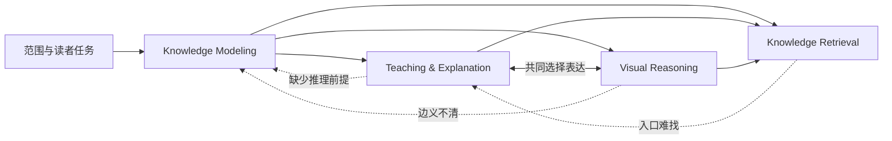

# low-cognitive-cost AI writing

Adaptive Technical Knowledge Writing System for personal study, research, public technical sharing, and later review. Aim for accurate technical writing that gives a peer a clear route through the mechanism.

## 第一层 · Writing Philosophy

先决定读者需要完成什么判断，再选择材料和解释方式。用 **Knowledge Selection** 划边界，用 **Reader Modeling** 判断读者已经知道什么，用 **Explanatory Sequencing** 安排知识进入顺序，用 **Making Implicit Relations Explicit** 补上关键推理，用 **Editorial Judgment** 决定展开、压缩、收束或停止。这五种能力指导整个写作过程。遇到范围、顺序、难度和长度之间的取舍，读 [写作哲学](references/writing-philosophy.md)。

## 第二层 · Scope & Document Router

1. 用一句问题说清当前稿件的承诺，并明确读者完成后能解释、预测、操作或查阅什么。按用户要求、材料和受众推断知识起点。
2. 划定 **Knowledge Slice**。主线纳入直接支撑这个承诺的机制、案例、证据和边界。相关内容仅需被定位时，用能访问的来源承接。复用技术原稿时保留切片内的事实、限定条件和重要出处。
3. 选择主模式。Concept 让读者识别、解释或区分一个概念。Tutorial 从可复现的起点走到可验证的结果。Deep Dive 让读者推断机制和条件变化的后果。Reference 让读者找到准确条目并行动。允许同一稿件按局部读者需求混用这些模式。
4. 应用 **One-hop Prerequisites**。前置索引只收录正文直接使用且读者需要回查的知识。写名称、用途和可访问入口。本次机制的对象和新符号在正文首次使用前交代。
5. 应用 **Local Rigor**。说明公式变量、相似写法、成立条件和局部推导。深度以读者目标为限。核对版本和来源，区分事实、假设、推导与实测。

用读者的任务和最难的一步分配篇幅。总控工作可以在短稿内直接完成，在复杂稿件里形成简要决策记录。

## 第三层 · 四个协作引擎

由同一个 Agent 使用同一份知识模型。模型是教学和视觉推理的上游。两者围绕同一个难点迭代。知识恢复利用模型和最终文档定位关键关系，并可反改正文。发现缺少前提或图形混义时，回到关系模型和范围。

| 引擎 | 路由与参考 |
| --- | --- |
| **Knowledge Modeling** | 先辨认依赖、因果、时间、数据与对照。主题互相牵连、需解释版本差异或核对证据时，读 [知识建模](references/knowledge-modeling.md)。 |
| **Teaching & Explanation** | 按读者当前的知识任务选择开头，定位最难跨的关系。设问后就地回答，完稿前对读问句标题和首段。实质改写或需要案例、计算、边界对照时，读 [教学表达](references/teaching-explanation.md)。 |
| **Visual Reasoning** | 先确定图要替读者完成的推理。涉及分支、汇合、反馈或跨节导航时，读 [视觉推理](references/visual-reasoning.md)。 |
| **Knowledge Retrieval** | 标出重新进入主机制、公式和证据的路径。长文、科研笔记或明确用于复习时，读 [知识恢复](references/knowledge-retrieval.md)。Quick Recall 按需使用。 |

小任务可以就地运用引擎。复杂改造加载相关参考一起工作。章节名、图的数量、是否举例和采取哪种解释顺序由当前读者任务决定。

## 第四层 · 贯穿式质量约束

- **Local Rigor**。逐项核对角色、假设、单位、极端情形、箭头语义和证据。
- **Cognitive Load Control**。实际走一次读者路径。找到需要跳读、对照符号或补演算的地方，选择更直接的解释方式。
- **Editorial Judgment**。用删减试验确定哪些内容应展开、保留、外移或收束。读者已经能作出判断时结束支线。

使用 [严谨性与编辑审查](references/rigor-and-editorial.md) 检查质量。需要观察方法怎样改变具体稿件时读 [案例与回归记录](references/examples.md)。复杂交付同时核对引用、公式、图源、渲染和导航。
